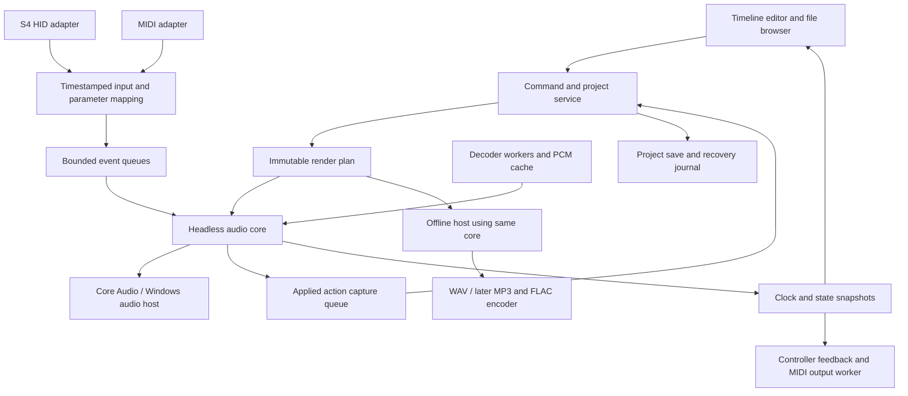

# System architecture

Status: Proposed. Updated 2026-11-04. See [stack decision](decisions/0001-platform-and-engine.md) for alternatives and [audio research](research/audio-engine-and-stack.md) for evidence.

## One musical model and one rendering core

The editable set is authoritative. A compiler turns a validated project snapshot into a render plan containing source mappings, parameter curves, ordered actions, and routing. The same DSP core consumes that plan in live playback and offline export. The UI and controller adapters submit semantic commands; neither owns audio time.

The offline host is a separate engine instance; exporting must not mutate the project or the interactive playback instance. MIDI/hardware side effects are disabled during offline render.

## Responsibilities

| Component | Owns | Must not do |
| --- | --- | --- |
| Project/editor service | Immutable snapshots, undo/redo, validation, takes, autosave | Mutate objects currently being traversed by the callback |
| Transport/compiler | Time mapping, action ordering, source schedules, parameter ownership | Use UI timers as the playback clock |
| Audio core | Mixing, source playback, smoothing, DSP state, effective event application | Block, allocate/free unpredictably, access files, log synchronously, call UI/USB APIs |
| Decoder/cache workers | File I/O, decoding, source-window prefetch, waveform caches | Require the callback to wait for data |
| Analysis workers | BPM/grid/key candidates and confidence, waveform summaries | Replace a project's user-edited grid silently |
| Controller adapters | Device protocol, timestamping, mappings, bounded feedback | Write project JSON or decide saved automation semantics |
| Persistence/export workers | Atomic project save, media verification, export encoding | Execute in the live audio callback |
| Host | Device enumeration, buffer negotiation, lifecycle, clock mapping | Leak platform handles into the set format |

Keep reference-count destruction, allocation, cache eviction, queue resizing, and plan reclamation off the audio thread. A lock-free container is not automatically bounded in work or safe in its destructor. Publish plans through an ownership handoff with an explicit acknowledgement/reclamation policy.

## Time and events

Live processing uses an integer sample-frame position on the audio device clock. Timestamp inputs on receipt using a monotonic host clock, map them into the engine clock, and record the **actual applied frame**. Pair it with a transport segment ID and that segment's engine-frame/project-position anchor; the engine counter alone does not identify arrangement time after a seek or restart. In the POC, stop or segment capture explicitly on seek, pause, device-clock reset, or sample-rate change. A new retake can start from a nonzero project position with a new anchor. Do not pretend an event received after its deadline can affect already-rendered samples. Track late-event counts and their lateness.

At each block, apply scheduled actions at their frame offsets; split processing into bounded spans where necessary. Curves can be evaluated per sample or in documented interpolated segments. Smooth discontinuous control targets to avoid zipper noise, with the smoothing policy versioned in the engine. Critical actions such as stop and clip activation must not be dropped behind meter traffic.

The project records musical intentions and resolved effects: parameter target/value, clip/source identity, play/stop/seek, playback-rate trajectory, and loop behavior as those features arrive. Raw HID/MIDI packets may be retained for diagnostic fixtures but are not the portable performance representation.

## Real-time limits and overload

Preallocate a bounded event pool, queues, decoder windows, and working buffers. Use producer-specific queues or a non-real-time merger; do not accidentally make a single-producer queue multi-producer. Document capacity and overflow behavior for every queue.

- Meter/UI snapshots may be dropped or coalesced.
- Intermediate control values may be coalesced only under a defined capture policy that preserves audible behavior.
- Capture queue loss marks the take incomplete and stops successful automation capture; never save a silently incomplete performance as verified.
- Decoder starvation produces a deliberate short fade to silence and a visible underrun record. The callback continues.
- Under sustained overload, disable optional analysis/visual work or request a larger buffer through the host. Do not change musical timing silently.

These starvation rules describe live playback. The offline host can block: it must wait for all required source windows **before** invoking the render core for a span. An unreadable source fails the export explicitly; a slow decoder must never turn into an apparently successful file containing starvation fades. Keep the core's processing nonblocking in both hosts.

At 48 kHz, 128 frames give approximately 2.67 ms to process one callback. That is a deadline, not end-to-end latency. Device buffering, scheduling, USB input, stretch lookahead, conversion, and physical output add latency. See [POC measurements](poc-plan.md).

## Audio signal path

For each active source: decode/prefetch → resample or stretch → trim/gain → later EQ/filter/FX → channel fader and crossfader assignment → master bus. Cue is a separately routed monitor bus. Define a crossfader law, gain units, pan law if added, and effect order in versioned DSP configuration.

The POC validates basic playback and resampling first. Pitch-preserving stretch is a separately benchmarked DSP step, not a free consequence of BPM sync. A stretcher must expose/characterize its startup, lookahead, and tail requirements. Account for algorithmic latency across parallel paths and retain preroll when seeking. Offline export must use the same declared processing mode for parity tests; an optional higher-quality export mode is an explicit different render choice.

Use one S4 audio device clock for master and cue where possible. Separate audio devices require an additional clock-drift/resampling design. Start the harness with stereo WAV sources, a 48 kHz engine, floating-point mixing, and PCM WAV export. Add MP3 decoding before the complete POC so it uses the actual library; broader import follows the [format matrix](audio-import-and-library.md). Decoding, header probing, tags, and encoding run outside the callback; source-frame seeking and encoder priming/trimming must agree across analysis, playback, and export.

## Seeking, loops, and edits during playback

Third-party effects are a confirmed version 2/3 requirement, outside the POC. Preserve room for stable effect-instance IDs, ordered clip/bus racks, parameter events, state blobs, latency/tail reporting, and a separate offline chain. Loading and state changes belong outside the callback. Native VST3 hosting also works behind a desktop web UI; browser-only delivery needs a native companion or frozen audio. The [plugin design](plugin-effects.md) defines the proposed lifecycle, compensation, and compatibility gates. POC code need not implement a plugin host.

Seeking must reconstruct the state at the destination: which clip is active, its source position, parameter values, and DSP history. A parameter snapshot alone cannot restore stretch or effect state. Use a bounded preroll or cached render checkpoints; if data is unavailable, show preparation state rather than producing an apparently successful but wrong playback.

Editing publishes a new validated plan at a defined boundary. Prevent use-after-free with an explicit generation/acknowledgement scheme. The POC may require transport stopped for clip-layout edits, while allowing control gestures during recording. Later revisions can adopt live editing with continuity rules.

Loops and scratching create non-monotonic source trajectories. They need explicit replay semantics and cannot be modeled merely as a clip's start/end and one constant playback rate. These are later gates, while the format reserves extensible action types.

## Web and native boundaries

Keep the core independent of the GUI toolkit and operating-system audio API. A browser host can eventually compile suitable core modules to Wasm and run them in AudioWorklet. A hybrid desktop UI communicates using versioned commands and snapshots; input events bypass the UI and go directly to the native engine. Audio must continue through a blocked or reloaded UI.

Do not introduce C++ plus Rust plus a web UI for the first engine experiment without evidence that each boundary is needed. A C++ core can support a web UI later without moving the audio callback into JavaScript. Detailed browser feasibility and experiments appear in [web research](research/web-platform.md).

## Maintenance and diagnostics

Pin dependency versions and record compile flags, platform, driver, and firmware in test reports. Keep deterministic synthetic audio fixtures; use redistributable material for listening tests. Build the headless renderer in CI before adding host-specific UI tests. Separate project migration tests, engine tests, and physical device qualification because none substitutes for the others.

Diagnostics should record callback duration distributions, decoder starvation, event lateness, queue pressure, selected device settings, and capture completeness. Write these through bounded queues to a worker. Avoid absolute media paths and device serial numbers in ordinary shared reports.
