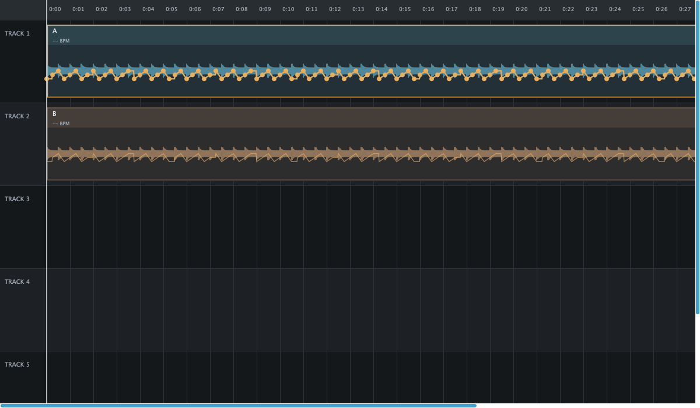

# Dense storage and viewport repair

The local regression stores the dense capture model within the existing 8 MiB limit and preserves every compiled point.
The painter visits a bounded slice of visible handles while keeping the stored curves intact.
Exact local source: `e2842daa54da2cb419360019af819f282d162f96`.
Clean CI passes on Linux, macOS and Windows at that exact source.
A repeated sustained run remains separate and has not yet completed.

## Storage

The [failed hour](2026-11-05-software-stress.md) retained every input but could not save its compiled take.
The new regression uses the same 107,999-input count, four stored points per second and one-hour frame range.
It uses short synthetic media to keep this storage test distinct from a sustained playback test.
The existing take compiler produces 149,169 points for its deterministic schedule.
The new file is 7,394,820 bytes, and reopening preserves every compiled point and identity.

The writer omits whitespace and formats known binary32 control fields with round-trip decimal text.
Metadata doubles retain binary64 precision, including values that originated as floats but belong to double fields.
Tests compare control bits at signed zero, subnormal values and adjacent float boundaries.
They also require exact double metadata and escaped Unicode strings after reopen.
The schema, point arrays, smoothing policy, validation and 8 MiB admission limit remain unchanged.

The stress collector releases timing histories after correlation and aggregate calculation, before project commit/save.
It retains the complete take until compilation.
The process peak measurement still covers the entire process, including every earlier stage and final save.
This is a memory-lifetime change, not a reset or exclusion of the measured peak.
Only the repeated hour can qualify the final process-memory target.

## Painting

The old painter visited every selected handle even when its circle lay outside the viewport.
The new slice uses sorted local frames and includes the handle radius plus a margin for far-timeline float rounding.
It preserves the full curve for evaluation, editing and storage.
Geometric tests scan 100,000 points across zoom levels, moved clips, trimmed lengths and near-24-hour positions.
They require every circle that can touch the viewport to remain in the slice and bound work by visible time.

The [local measurement](data/2026-11-05-dense-save-and-paint.json) paints 100 warm frames of the actual arrangement component.
The synthetic project is one hour long with 14,401 points in every clip parameter.
At the hour workload's ten pixels per second, paint p99 is 6.128 ms and maximum is 6.362 ms.
That short isolated measurement is below the 20 ms paint interval but does not establish sustained 50 Hz behavior.
All seven local suites pass, and the refactored stress smoke also passes.

The image below uses forty pixels per second so individual points remain legible.
It is an offscreen production-component render from synthetic sources, not a native preview-window inspection.
The native Mac preview remains preserved while the UI tool reports a locked session.

## Clean cross-platform checks

[Run 42020134400](https://github.com/coder13/Fader/actions/runs/42020134400) passes five Linux core suites and seven native suites on each of macOS and Windows.
Downloaded build metadata, JUnit and full logs match source `e2842daa54da2cb419360019af819f282d162f96`, the pinned JUCE revision and UI fixtures OFF.
There are no failed, erroneous or skipped suites.
The [aggregate evidence](data/2026-11-05-dense-save-ci.json) records the toolchains, counts and limits.

Both native hosts compile the same 107,999-control storage workload into 149,169 points and reopen every point and identity.
The manifest is 7,394,820 bytes on macOS and 7,383,039 bytes on Windows.
Platform decimal formatting differs; both preserve the checked binary32 target bits and binary64 metadata within the unchanged 8 MiB bound.
These are short-media storage tests, not sustained playback.

The two-second CI smokes preserve all 247 controls, streamed audio and saved projects.
Their ordinary-priority hosts have 506 virtual deadline misses on the shared macOS runner and 16 on Windows.
The macOS smoke also misses the predicted-latency target.
The smoke acceptance checks functional integrity, so successful CI does not qualify those timing targets or a full hour.
The dedicated real-time hour must supply its own result.

## Remaining qualification

All 70 tracked source, test and CMake files match the local build source byte for byte.
The local build uses Release, AppleClang 21, CMake 4.4.4, pinned JUCE and UI fixtures ON.
Default clean CI keeps UI fixtures OFF and covers the numeric, geometry, project and failure cases above.

The original 128-frame hour's twelve virtual deadline misses remain unexplained by its aggregate alone.
Its callback maximum also exceeded the deadline despite low typical execution times.
Further diagnostics must retain outlier frames and distinguish callback duration from wake lateness before assigning a cause.
Keep the original duration, density, memory and timing targets for the next qualification.
This local repair does not close #40 or replace its failed evidence.
